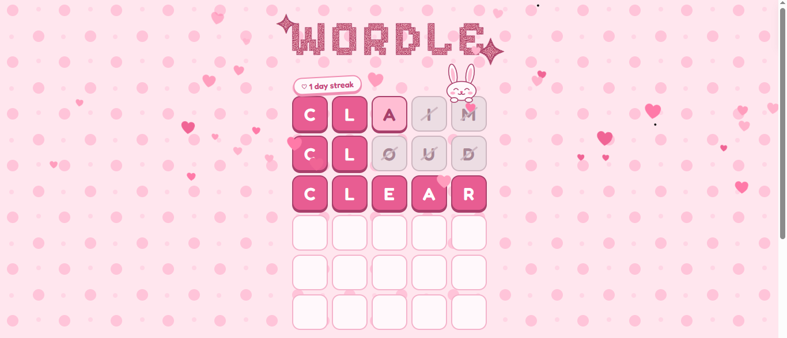

WORDLE

A cute Wordle clone I made with HTML, CSS and JavaScript. There are no libraries and nothing to install, you just open the page and play.

**Play it here:** https://b1ntii.github.io/wordle-clone/

## How it works as a game

Same idea as the original. You get six guesses to find a hidden five letter word. After each guess the tiles flip over and tell you which letters are in the right place, which are in the word but somewhere else, and which aren't in it at all. You can type on your keyboard or use the one on screen, and the on-screen keys change color as you go.

## The cute stuff

I wanted it to look like something you'd put a sticker on, so a lot of the work went into the little details.

The title has a glitter texture. It's not an image, it's a noise filter made in CSS and clipped to the letters.

There's a bunny sitting on the corner of the board. It twitches its ears if you try to submit a word that's too short, hops when you win, and cries with one tear when you lose.

When you win, the row bounces tile by tile and hearts float up the screen.

The streak sticker keeps track of how many days in a row you've won. It's saved in your browser, so it's only on the device you played on.

Wrong letters get crossed out, the cursor is a heart, and the keys squish a bit when you press them. If your device is set to reduce motion, the animations are turned off.

## Running it on your own computer

Download the files (green **Code** button, then **Download ZIP**), unzip them, and open `index.html` in a browser.

The page loads two fonts from Google Fonts (Fredoka and Pixelify Sans), so you need internet for the title and text to look right. Without it the game still works, it just uses plain fonts.

## What's in the folder

- `index.html` has the page and the bunny drawing (it's an inline SVG)
- `style.css` has the colors, layout and animations
- `script.js` has the game logic, the streak, and the bunny's moods

## How guesses get checked

Repeated letters are the annoying part. If the answer is `ABIDE` and you guess `SPEED`, only one of your E's should be marked, not both. So the check runs twice. The first pass marks the exact matches and counts which letters of the answer are still unmatched. The second pass only marks a letter as "in the word" if there's still an unmatched copy left. The function is called `evaluate` in `script.js`.

## Changing things

The word list is the `ANSWERS` list near the top of `script.js`. I only put in about 300 common words, so swap in a bigger list if you want more variety.

Right now the game accepts any five letters as a guess, even if it isn't a real word. If you add a bigger word list, you can set `REQUIRE_REAL_WORD` to `true` in `script.js` to turn on checking.

The colors are all variables at the top of `style.css`. The number of hearts on a win is `rainHearts(n = 30)` in `script.js`.

To reset your streak, open the browser console and run `localStorage.removeItem("wordle-streak")`.

## Credits

Based on Wordle, which was made by Josh Wardle and is now owned by The New York Times. This is just a fan project and has nothing to do with them.
